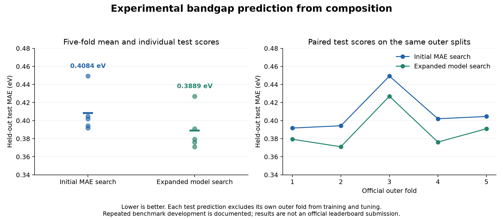
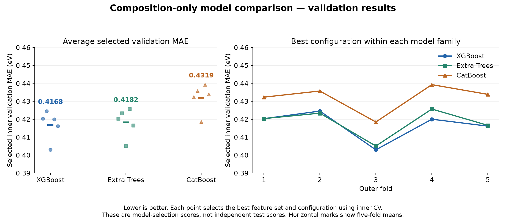

# MatBench Experiments

This repository explores building machine learning predictors for different materials properties using [Matbench datasets](https://matbench.materialsproject.org/). The aim is to investigate how choices of material representation, model, and hyperparameters affect predictive performance, and to compare the results with leading methodologies reported on the [Matbench leaderboard](https://matbench.materialsproject.org/).

## Starting point: experimental bandgap prediction

The project began with the `matbench_expt_gap` dataset, predicting experimental bandgaps from chemical composition. The initial experiments use Magpie composition features, random forests, and XGBoost, including Bayesian hyperparameter optimisation.

[matbench-bandgap-predictor.ipynb](matbench-bandgap-predictor.ipynb) records this initial work and its results. Future experiments will explore additional materials properties and prediction approaches.

The historical notebook uses its own train/test split and is not directly leaderboard-comparable. The later experiments below use the official Matbench outer folds.

## Results: composition-only bandgap prediction

The expanded search achieves **0.3889 eV mean held-out test MAE** on `matbench_expt_gap` (4,604 compositions), with a fold-to-fold population standard deviation of **0.0201 eV**. This is a **4.8% reduction in mean MAE** relative to the initial nested MAE search, using the same official outer splits.

| Experiment | Mean test MAE (eV) | Fold standard deviation (eV) |
|---|---:|---:|
| Initial nested MAE search | 0.4084 | 0.0210 |
| Expanded model comparison | **0.3889** | **0.0201** |



The expanded experiment compares 20 configurations per model family—XGBoost, CatBoost, and Extra Trees—across three composition feature sets, totalling 2,700 inner-validation fits. XGBoost and CatBoost include both squared-error and absolute-error training losses; **selection always minimises validation MAE**. Matching configurations are reused across feature sets.



XGBoost and Extra Trees achieved similar selected inner-validation scores in this search; CatBoost had higher validation error. These are **model-selection scores, not independent test scores for each model family**. Final selection chose XGBoost for four outer folds and Extra Trees for one. Every selected model used full Magpie statistics plus element fractions, stoichiometry, and valence-orbital descriptors.

### Evaluation and limitations

Each official outer fold has an independent three-fold inner search. Feature and model selection, imputation, and constant-feature removal use only that outer fold’s training portion. All five selected models are fitted and saved before final test evaluation. No crystal structures or additional training datasets are used.

The two experiments are successive rounds of benchmark development on a public dataset, and earlier test results have been inspected. The reported improvement is descriptive; it is not an independent confirmation on a new dataset or a claim of state-of-the-art performance. These results have not been submitted to or verified by the Matbench leaderboard. The historical notebook’s single-split score is excluded from the comparison table.

### Explore and reproduce

- [Historical course-derived notebook](matbench-bandgap-predictor.ipynb)
- [Initial nested MAE experiment](matbench-bandgap-predictor-mae.ipynb)
- [Expanded model-comparison notebook](matbench-bandgap-predictor-model-comparison.ipynb)
- [Per-fold final test scores](results/model-comparison/test_scores.csv), [inner-validation results](results/model-comparison/inner_validation.csv), and [frozen search protocol](results/model-comparison/protocol.json)
- [Matbench prediction export](results/model-comparison/matbench_results.json.gz)

Run notebook cells sequentially to reproduce training and final evaluation. The expanded search can take around two hours on the machine used for this run; timings vary. Installed environments and fitted binary models are excluded from Git. Recreate the test-comparison figure from saved scores with `uv run python scripts/plot_benchmark_results.py`.

## Inspiration and acknowledgements

This work was inspired by completing Prof Aron Walsh’s **Machine Learning for Materials** lecture course at Imperial College London. It began with my work in Lecture9 of the [course repository](https://github.com/aronwalsh/MLforMaterials), then developed into this independent project.

The course was developed by Aron Walsh with assistance from Anthony Onwuli and Zhenzhu Li. The original teaching material is credited to its authors.

## Matbench reference

Matbench provides datasets and an evaluation framework for materials property prediction. Dataset information and published results are available on the [Matbench website](https://matbench.materialsproject.org/), with code in the [Matbench repository](https://github.com/materialsproject/matbench).

Dunn, A., Wang, Q., Ganose, A., Dopp, D. & Jain, A. **Benchmarking materials property prediction methods: the Matbench test set and Automatminer reference algorithm.** *npj Computational Materials* **6**, 138 (2020). [doi:10.1038/s41524-020-00406-3](https://doi.org/10.1038/s41524-020-00406-3).

## Run locally

Install [uv](https://docs.astral.sh/uv/), then run from this directory:

```sh
uv sync --locked
uv run jupyter lab
```

Select the Python environment belonging to this project. The notebook downloads its dataset through matminer and requires internet access for the first download. Hyperparameter optimisation can take substantial time.

The Python 3.12 environment definitions and full course dependency set are retained in `pyproject.toml`, `uv.lock`, and `.python-version`. The small `src/mlformaterials` scaffold supports the existing package configuration. Installed virtual environments are recreated locally and are not committed.

## License notice

[LICENSE](LICENSE) is copied unchanged from the course repository and contains CC0 1.0 Universal. The upstream README displays a CC-BY 4.0 badge instead. This discrepancy is recorded here without resolving it or asserting a different license for the course material. Dataset and third-party library terms remain separate.

## MAE benchmark experiment

[MAE-focused notebook](matbench-bandgap-predictor-mae.ipynb) uses official Matbench outer folds, three-fold inner validation, and a fixed small XGBoost search. The historical notebook uses its own split and is not directly leaderboard-comparable. Run all cells sequentially; final test scoring occurs only after all five models are frozen. Local model artifacts are ignored; result tables and the Matbench export support reproducibility.

## Controlled model comparison

[Model comparison notebook](matbench-bandgap-predictor-model-comparison.ipynb) compares 20 configurations each of XGBoost, CatBoost, and Extra Trees across the same three composition feature sets. Selection uses inner MAE, with official outer test scoring delayed until all models are frozen. Results are saved separately under `results/model-comparison/`.
